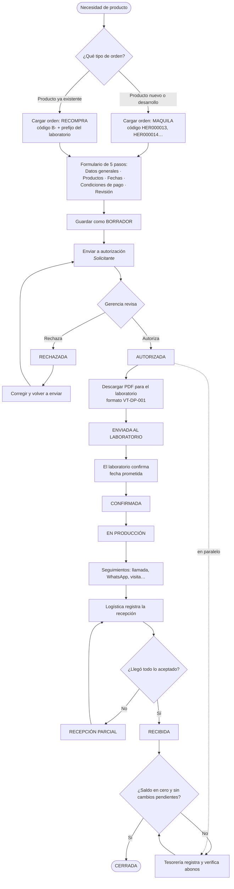
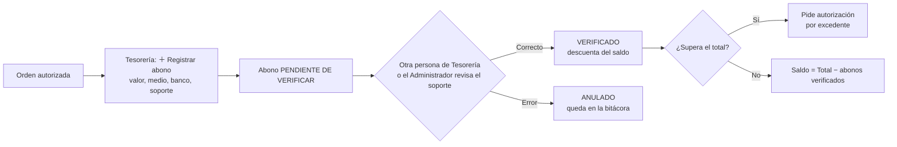
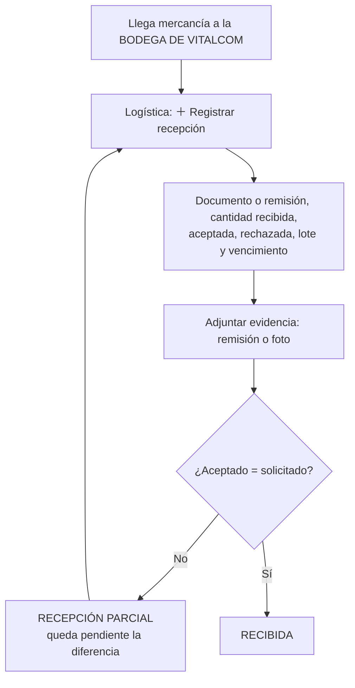
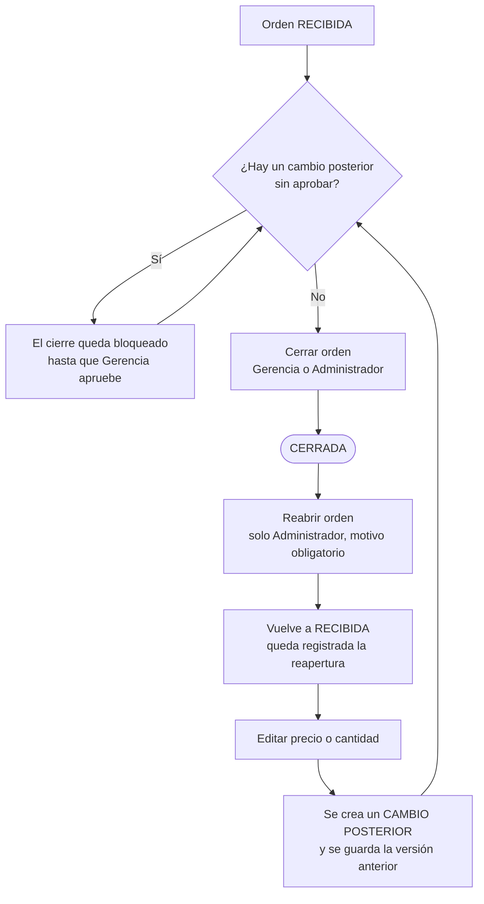
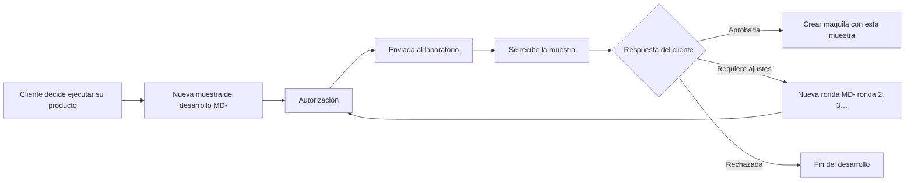
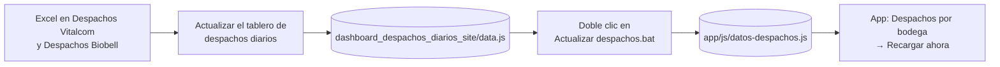
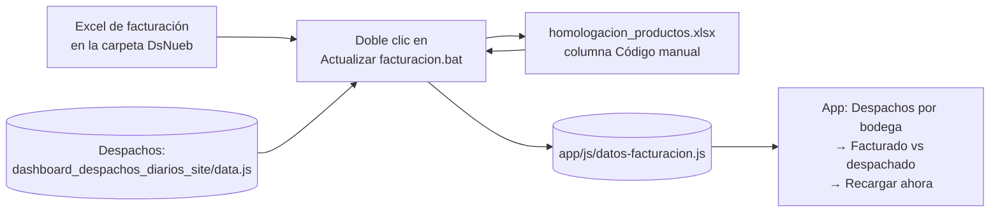

# Control de Maquilas Vitalcom — Manual paso a paso y flujogramas

> **VITALCOM GROUP COMMERCE SAS** · NIT 901853112 · Formato VT-DP-001 (versión 0001, vigencia 06/03/2025)
> Datos tomados de la base de la aplicación con corte al **8 de octubre de 2026**. Actualizado el 9 de octubre de 2026 con las **muestras de desarrollo** (punto 5.11).

**Resumen al corte:** 24 órdenes registradas (10 maquilas y 14 recompras) en 5 laboratorios. Valor total: **$768.858.060**. Abonos verificados: **$37.200.000**. Saldo por pagar: **$731.658.060**.

---

## Contenido

1. [Cómo abrir la aplicación](#1-cómo-abrir-la-aplicación)
2. [Perfiles y quién hace qué](#2-perfiles-y-quién-hace-qué)
3. [Flujograma general del proceso](#3-flujograma-general-del-proceso)
4. [Estados de una orden](#4-estados-de-una-orden)
5. [Paso a paso](#5-paso-a-paso)
6. [Despachos por bodega](#6-despachos-por-bodega) (incluye 6.1 Facturado vs despachado)
7. [Respaldo de la información](#7-respaldo-de-la-información)
8. [Estado actual de las órdenes](#8-estado-actual-de-las-órdenes)
9. [Puntos a revisar](#9-puntos-a-revisar)

---

## 1. Cómo abrir la aplicación

1. Entre a la carpeta `Documents\Mayo 2026\Control de Maquilas Vitalcom`.
2. Haga doble clic en **`Abrir Control de Maquilas.bat`**. También puede usar el acceso directo del escritorio, que se crea una sola vez con `Crear acceso directo en el escritorio.bat`.
3. La aplicación se abre en una ventana propia de Edge o Chrome. **No necesita internet.**
4. Elija su usuario y escriba su PIN.
5. Entra al **Tablero principal**.

> ⚠️ La información se guarda en la carpeta **`datos`**. Nunca la borre ni la mueva. Para actualizar la aplicación solo se reemplaza la carpeta `app`.

**Menú lateral:** Tablero · Órdenes · Cargar orden · Centro de alertas · Autorizaciones · Pagos y saldos · Recepciones · Despachos por bodega · Reportes y exportación · Bitácora · Configuración.

---

## 2. Perfiles y quién hace qué

Estos son los usuarios que hay hoy en la aplicación:

| Usuario | Perfil | Puede |
|---|---|---|
| Administrador | Administrador | Todo, incluidas la configuración, la restauración de respaldos y **reabrir órdenes cerradas** |
| Coordinación de Compras | Solicitante | Crear y editar órdenes, enviarlas a autorización, marcarlas enviadas, confirmadas o en producción, y registrar seguimientos |
| Gerencia | Autorizador | Autorizar o rechazar órdenes y cambios, y cerrar, suspender o cancelar órdenes |
| Tesorería | Tesorería | Registrar, verificar y anular abonos |
| Logística Bodega | Logística | Registrar y anular recepciones de mercancía |
| Consulta | Consulta | Solo ver y exportar |

**Reglas de control:**
- Quien solicita una orden **no puede autorizarla** (salvo el Administrador).
- Quien registra un abono **no puede verificarlo** (salvo el Administrador).
- Nada financiero se borra: los abonos y las recepciones se **anulan** y la anulación queda registrada en la bitácora.

---

## 3. Flujograma general del proceso

**Pagos y recepciones en paralelo:** los abonos se pueden registrar desde que la orden está autorizada. Las recepciones se registran cuando llega mercancía.

---

## 4. Estados de una orden

```mermaid
stateDiagram-v2
    direction LR
    Borrador --> Pendiente: Enviar a autorización
    Pendiente --> Autorizada: Autorizar
    Pendiente --> Rechazada: Rechazar
    Rechazada --> Pendiente: Reenviar
    Pendiente --> Borrador: Devolver a borrador
    Autorizada --> Enviada: Marcar enviada
    Enviada --> Confirmada: Laboratorio confirmó
    Confirmada --> Produccion: Pasar a producción
    Produccion --> Parcial: Recepción incompleta
    Produccion --> Recibida: Recepción completa
    Parcial --> Recibida: Se completa
    Recibida --> Cerrada: Cerrar orden
    Cerrada --> Recibida: Reabrir (solo Administrador)

    Pendiente: Pendiente de autorización
    Enviada: Enviada al laboratorio
    Produccion: En producción
    Parcial: Recepción parcial
```

Desde casi cualquier estado activo una orden también puede pasar a **Suspendida** (y luego **Reanudar**) o a **Cancelada**. Estas acciones las hacen Gerencia o el Administrador.

**Cuántas órdenes hay en cada estado hoy:**

| Estado | Órdenes | Códigos |
|---|---:|---|
| Borrador | 0 | — |
| Pendiente de autorización | 4 | HER000011, B-BIO00017, B-NM00007, B-NP00011 |
| Autorizada | 0 | — |
| Enviada al laboratorio | 5 | HER000006, HER000007, HER000008, B-HER00012, B-NH00019 |
| Confirmada | 2 | HER000012, B-NP00010 |
| En producción | 10 | HER000004, HER000005, HER000009, HER000010, B-HER00011, B-NH00015, B-NH00016, B-NH00017, B-NH00018, B-NM00006 |
| Recepción parcial | 2 | HER000003, B-NP00009 |
| Recibida | 0 | — |
| Cerrada | 1 | B-HER00010 |

---

## 5. Paso a paso

### 5.1 Cargar una orden

1. Menú **＋ Cargar orden**.
2. Elija el tipo de orden:
   - **Maquila**: producto propio fabricado por el laboratorio. Usa un consecutivo global; la próxima será **HER000013**.
   - **Orden de producción por recompra**: producto que ya se compra al laboratorio. Cada laboratorio lleva su propio consecutivo:

     | Laboratorio | Prefijo | Última orden | Próxima |
     |---|---|---|---|
     | Herix Lab | HER | B-HER00012 | **B-HER00013** |
     | Bioffset Quimics | BIO | B-BIO00017 | **B-BIO00018** |
     | Natural Health | NH | B-NH00019 | **B-NH00020** |
     | Naturalsplast | NP | B-NP00011 | **B-NP00012** |
     | Nature's Market | NM | B-NM00007 | **B-NM00008** |

   - **Muestra de desarrollo**: cuando un cliente decide ejecutar su producto, primero se pide la muestra al laboratorio. Usa su propio consecutivo: **MD-00001**, MD-00002… Ver el punto [5.11](#511-muestras-de-desarrollo).

3. Llene los **5 pasos** del formulario:
   1. **Datos generales**: cliente (VITALCOM), laboratorio y prioridad (Normal, Alta o Urgente). Al elegir el laboratorio se cargan solos su NIT, contacto, teléfono y correo. Si los cambia, quedan guardados en la ficha del laboratorio.
   2. **Productos**: producto, presentación, gramaje, cantidad, precio, IVA (%) y costo adicional.
      - En recompra son obligatorios el código (ID), la cantidad y el precio.
      - Si el producto no existe, escríbalo o use **＋ Nuevo**. Se agregará al catálogo al guardar la orden.
   3. **Fechas**: envío, confirmación, entrega prometida y responsable del seguimiento.
   4. **Condiciones de pago**: Contado, Crédito o Financiado.
      - Para Financiado se pide cuota inicial, número de cuotas y periodicidad. Ejemplo: en HER000003 se pagó un 50 % de anticipo y el saldo en 2 cuotas quincenales.
   5. **Revisión**: revise totales e impuestos y guarde.
4. La orden queda en **Borrador**.

> 💡 El total se calcula así: cantidad × precio + IVA + costo adicional (+ intereses si es financiada).
> Ejemplo: HER000010 GLUWEN GEL, 1.000 × $8.800 = $8.800.000 + IVA 19 % = **$10.472.000**.

### 5.2 Enviar a autorización y autorizar

1. Abra la orden y pulse **Enviar a autorización**. El estado pasa a *Pendiente de autorización*.
2. Gerencia (o el Administrador) entra al menú **Autorizaciones** y pulsa **Autorizar** o **Rechazar**, con un comentario.
3. Si se rechaza, la orden se corrige y se vuelve a enviar.

Hoy hay **4 órdenes esperando autorización**: HER000011, B-BIO00017, B-NM00007 y B-NP00011.

### 5.3 Enviar la orden al laboratorio

1. En el detalle de la orden, pulse **⬇ PDF para laboratorio**.
2. Elija qué incluir: precios, condiciones, firmas, fecha requerida y observación. Las especificaciones internas están desactivadas por defecto.
3. Revise la vista previa y descargue el archivo `Orden_<código>_<laboratorio>.pdf`.
4. Envíelo al laboratorio por correo o WhatsApp.
5. Marque **Marcar enviada al laboratorio**. Una copia del PDF queda en la pestaña **Archivos**.

> El PDF sale con marca de agua si la orden todavía no está autorizada. La columna de entrega dice "ENTREGAR EN LA BODEGA".

### 5.4 Confirmación y producción

1. Cuando el laboratorio responde, pulse **Laboratorio confirmó** y registre la fecha prometida.
2. Cuando el laboratorio inicia, pulse **Pasar a producción**.

### 5.5 Registrar seguimientos

En la pestaña **Seguimiento**, pulse **＋ Registrar seguimiento** y anote:
- medio (llamada, WhatsApp, correo, visita…);
- la conversación y los compromisos;
- la nueva fecha prometida, si cambió.

Ejemplos de seguimientos ya registrados:
- *B-NH00016 (05/10, WhatsApp):* "Indica el Sr. Carlos que realiza entrega del TITANTURK el día de mañana."
- *B-HER00010 (05/10, WhatsApp):* "Se realizó solamente la entrega parcial de un producto y queda saldo a favor."
- *HER000004 (05/10, visita):* "Entregas de los productos."

Si una orden pasa varios días sin seguimiento, la aplicación genera una alerta (ver 5.9).

### 5.6 Pagos y abonos

1. Pestaña **Pagos** → **＋ Registrar abono**. Adjunte el comprobante.
2. Otra persona lo **verifica**. Solo los abonos verificados descuentan del saldo.
3. Para pagos de contado, el pago vence contra la entrega (fecha real o prometida). Si no hay fecha, el pago queda *Pendiente*, no *Vencido*.

Abonos verificados hasta hoy:

| Orden | Abono | Medio |
|---|---:|---|
| HER000003 | $6.750.000 | Transferencia (anticipo del 50 %) |
| HER000004 | $4.900.000 | Transferencia |
| HER000006 | $6.300.000 | Transferencia |
| HER000008 | $11.250.000 | Transferencia |
| HER000010 | $8.000.000 | Transferencia |
| **Total** | **$37.200.000** | |

### 5.7 Recepción de mercancía

Recepciones registradas hasta hoy:

| Orden | Documento | Recibido / aceptado | Solicitado | Pendiente |
|---|---|---:|---:|---:|
| HER000003 PRIMEVITAL | Remisión NM-4581 (lote PV260930) | 400 | 1.000 | 600 |
| B-NP00009 CAYENNE PEPPER | 1918 · 1925 · 1925 | 1.000 + 1.800 + 1.209 = 4.009 | 5.000 | 991 |
| B-HER00010 LYMPHATIC DRAINAGE | 2033 · 280 | 9.720 + 280 = 10.000 | 10.000 | 0 (cerrada) |

### 5.8 Cerrar, reabrir y cambios posteriores

- **Cambios posteriores:** si después de autorizar se cambia la cantidad, el precio, el laboratorio, la fecha prometida o el pago, la aplicación crea una solicitud de *Cambio posterior a la autorización* y guarda la versión anterior. Hasta que se apruebe, la orden no puede avanzar. Hasta hoy se han aprobado **6 cambios posteriores** y **1 reprogramación de entrega**.
- **Suspender / Cancelar:** lo hacen Gerencia o el Administrador desde el detalle de la orden, con un motivo.

### 5.9 Alertas

El **Centro de alertas** avisa según la configuración actual:

| Alerta | Se activa a los |
|---|---|
| Contactar al laboratorio | 2 días |
| Laboratorio sin confirmar | 2 días |
| Entrega próxima a vencer | 5 días antes |
| Pago próximo a vencer | 5 días antes |
| Orden sin seguimiento | 5 días |
| Borrador sin enviar | 3 días |
| Recordatorio de respaldo | 7 días |

### 5.10 Reportes

En el menú **Reportes y exportación** hay 12 reportes en Excel que se pueden filtrar por tipo (Maquila, Recompra o Muestra). El reporte **Muestras de desarrollo** muestra proyecto, cliente, ronda, situación, respuesta del cliente y la maquila que se generó. En el detalle de cada orden también están **⎙ Imprimir orden** y **⬇ Excel**.

### 5.11 Muestras de desarrollo

Antes de producir el producto de un cliente, el laboratorio desarrolla una muestra. La app la controla como una orden más (autorización, envío al laboratorio, seguimiento, recepción y pagos) y agrega la respuesta del cliente.

1. **＋ Cargar orden → Nueva muestra de desarrollo**.
2. En **Datos generales** diligencie el **proyecto**, el **cliente** que pide el desarrollo, su contacto, la fecha en que lo necesita y el **brief** (qué quiere el cliente). Estos datos son internos: no salen en el PDF para el laboratorio.
3. En **Muestras solicitadas** escriba el nombre tentativo, la presentación, el gramaje, el sabor/aroma/color, la **cantidad de muestras**, el costo (puede ser **$0** si el laboratorio no la cobra) y la **fórmula y especificaciones**. Este nombre tentativo no se agrega al catálogo.
4. Siga el flujo normal: enviar a autorización, autorizar, **⬇ PDF para laboratorio** (sale como *Solicitud de muestra de desarrollo* con la fórmula y la petición de ficha técnica y cotización), marcar enviada y registrar la recepción.
5. Cuando el cliente responda, pulse **☑ Respuesta del cliente** y elija:
   - **Aprobada por el cliente** → botón **✦ Crear maquila con esta muestra**. Se abre una maquila nueva con el laboratorio y los productos copiados; solo falta poner la cantidad, el precio de producción y la etiqueta. La maquila queda enlazada con la muestra.
   - **Requiere ajustes** → botón **⟳ Solicitar nueva ronda con ajustes**. Se crea otra muestra (ronda 2, 3…) con los ajustes del cliente en la observación.
   - **Rechazada por el cliente** → queda registrado y el desarrollo termina.
   - **Pendiente de evaluación** sirve para dejar constancia de que la muestra ya se entregó al cliente.
6. Puede anexar el soporte de la respuesta (correo, chat o acta). Queda en la pestaña **Archivos**.

**Alertas nuevas** (categoría *Muestras de desarrollo*):
- *Muestra sin respuesta del cliente*: pasaron 7 días desde que llegó o se entregó al cliente y no hay respuesta. Los días se cambian en **Configuración › Alertas**.
- *Muestra aprobada sin maquila creada*.
- *Fecha requerida por el cliente*: se acerca o ya pasó la fecha en que el cliente necesitaba la muestra.

El prefijo (**MD-**), el siguiente consecutivo y la observación por defecto se cambian en **Configuración › Empresa y códigos**.

---

## 6. Despachos por bodega

Esta pantalla es **solo de consulta**: muestra cuántas unidades salen cada día de las bodegas **Vitalcom** y **Biobell**. No modifica órdenes ni inventario.

**Para traer los días nuevos:**
1. Actualice primero el tablero de despachos diarios.
2. Haga doble clic en **`Actualizar despachos.bat`**. Necesita Python instalado en el equipo.
3. En la aplicación, entre a **Despachos por bodega** y pulse **Actualizar → Recargar ahora**.

**En la pantalla puede:**
- filtrar por bodega, rango de fechas y producto;
- ver los indicadores (unidades, promedio diario, participación por bodega, referencias);
- ver el top 15 de productos;
- abrir el detalle de cada día con plataformas y transportadoras;
- exportar a Excel.

**Datos cargados hoy:** del 26/02/2026 al 05/10/2026 (actualizados el 06/10/2026). Son 277 registros por día y bodega, con 426 productos.

### 6.1 Facturado vs despachado (16/10/2026)

Pestaña dentro de **Despachos por bodega**. Compara, producto por producto, lo que se **facturó** con lo que **salió de bodega**, para detectar producto que sale sin facturarse. También es solo de consulta.

**Para actualizar:**
1. Exporte la facturación del sistema (columnas `fecha, prefijo, numero, idvendedor, idproducto, nombreproducto, unidades, precio_unitario, preciotot`) y guárdela en la carpeta **`DsNueb`**. Se usa siempre el Excel más reciente de esa carpeta.
2. Doble clic en **`Actualizar facturacion.bat`**. Primero trae los despachos nuevos y después arma el cruce. Si `homologacion_productos.xlsx` está abierto en Excel, ciérrelo antes.
3. En la aplicación: **Despachos por bodega → Facturado vs despachado → Actualizar datos → Recargar ahora**.

**Cómo se leen las cifras:**
- **Diferencia = despachado − facturado.**
  - 🔴 **Sale sin facturar** (diferencia positiva): salió más producto del que se facturó. Es la señal de posible producto perdido.
  - 🟡 **Facturado sin despachar** (negativa): se facturó y no aparece despachado (pendiente, despacho por otra vía o error de registro).
  - 🟢 **Cuadra**: la diferencia no pasa de la tolerancia (5 % por defecto, mínimo 2 unidades).
- **Valor estimado** = diferencia × precio unitario promedio facturado del producto.
- **Canales**: por defecto la bodega Vitalcom se compara con los canales de e-commerce (Dropi, Mercado Libre, EffiCommerce, Mastershop, Página Web y los cuatro EFFI). Minoristas, Maquila, Mayoristas, Varios y Liquidación se pueden marcar si también salen por esa bodega.
- **Obsequios** (productos que empiezan por "OBSEQUIO") no se cuentan, salvo que se marque la casilla, porque salen de bodega pero normalmente no se facturan.
- **Fletes, comisiones y servicios** (`TRANS1234`, `S-COMREF`, `SERV01`) no se cuentan: no son producto físico.
- **Biobell** factura con su propia empresa. Solo se puede comparar con lo que Vitalcom le factura (canal 5), que es un traslado: sirve como referencia de volumen, no como cuadre exacto.
- La facturación de algunos canales es por lotes (por ejemplo, EFFI FREDDY factura varios días juntos), así que el cuadre diario no sirve para un solo día. Mire el **mes** o el **acumulado** del detalle del producto.

**Diccionario de canales (`idvendedor`):** 1 Minoristas · 2 Maquila · 3 Dropi · 4 Mayoristas · 5 Biobell · 6 Mercado Libre · 7 EffiCommerce · 8 Mastershop · 9 Varios · 10 Página Web · 11 EFFI DALLE · 12 EFFI CHONTAFLUX · 13 EFFI FREDDY · 14 EFFI VITALLIFE · 15 Comisiones referidos · 16 Liquidación. Los códigos 0 y 17 aparecen en la facturación sin nombre.

**Homologación de productos.** La planilla de despacho escribe los nombres a mano ("ADEUS.L", "LIMPHATIC"…), la facturación usa código. El programa los empareja solo (nombre exacto, código de la planilla, nombre contenido o nombre muy parecido) y deja todo en **`homologacion_productos.xlsx`**:
- Los nombres en rojo (*Sin homologar*) **no entran al cruce**. Escriba el código correcto en la columna amarilla **Código manual** (tiene lista desplegable) o **EXCLUIR** si ese nombre no se factura.
- Si un emparejamiento automático está mal, corríjalo igual, en **Código manual**. Lo manual siempre manda y se conserva en cada actualización.
- La hoja *Catalogo facturacion* lista todos los códigos facturados y si tienen despacho asociado.

**Exportar a Excel** genera: Por producto · Por mes · Diario · Facturas · Sin homologar.

**Primera carga (16/10/2026):** facturación del 02/01/2026 al 15/10/2026 (33.685 líneas). El cruce arranca el 01/06/2026 porque antes los despachos no traen unidades (Vitalcom trae unidades desde el 01/07/2026). Del 01/07 al 15/10, bodega Vitalcom contra e-commerce: 215.319 unidades facturadas, 242.122 despachadas (+26.803, 12,4 %); el 97 % de lo despachado por Vitalcom quedó homologado automáticamente.

---

## 7. Respaldo de la información

1. Menú **Configuración → Respaldo → Crear respaldo**. Se descarga un archivo `.cmvbak` con todo, incluidos los adjuntos.
2. Guarde ese archivo fuera del equipo (Drive, USB o correo).
3. Para restaurar se usa **Restaurar respaldo** (solo el Administrador). Antes de restaurar, la aplicación hace automáticamente un respaldo de lo que hay.

> Último respaldo: **05/10/2026**. Con el recordatorio de 7 días, el próximo debe hacerse a más tardar el **12/10/2026**.

---

## 8. Estado actual de las órdenes

*Corte: 08/10/2026. ⚠️ = la fecha de entrega prometida ya pasó y la orden no se ha recibido. 📌 = la entrega vence hoy.*

### Maquilas ($170.200.000)

| Código | Laboratorio | Producto(s) | Unid. | Total | Estado | Pago | Abonado | Saldo | Recibido | Entrega prometida |
|---|---|---|---:|---:|---|---|---:|---:|---:|---|
| **HER000003** | Nature's Market | PRIMEVITAL COLLAGEN | 1.000 | $13.500.000 | Recepción parcial | Financiado | $6.750.000 | $6.750.000 | 400 | 08/10 📌 hoy |
| **HER000004** | Nature's Market | PULZEN | 1.000 | $7.500.000 | En producción | Contado | $4.900.000 | $2.600.000 | — | 10/10 |
| **HER000005** | Nature's Market | PATRONA | 1.000 | $15.000.000 | En producción | Financiado | — | $15.000.000 | — | 17/10 |
| **HER000006** | Herix Lab | DERMUNEX CLEAR | 1.000 | $12.300.000 | Enviada al laboratorio | Contado | $6.300.000 | $6.000.000 | — | 04/10 ⚠️ |
| **HER000007** | Nature's Market | CREATINA POLVO YESNAP X30S | 1.000 | $21.000.000 | Enviada al laboratorio | Financiado | — | $21.000.000 | — | 30/10 |
| **HER000008** | Nature's Market | NEORAL SOFTGEL X60U | 1.000 | $15.000.000 | Enviada al laboratorio | Contado | $11.250.000 | $3.750.000 | — | 04/10 ⚠️ |
| **HER000009** | Herix Lab | CANDELA | 1.000 | $13.500.000 | En producción | Contado | — | $13.500.000 | — | 07/10 ⚠️ |
| **HER000010** | Herix Lab | GLUWEN GEL | 1.000 | $10.472.000 | En producción | Contado | $8.000.000 | $2.472.000 | — | 07/10 ⚠️ |
| **HER000011** | Herix Lab | GLUWEN CREMA | 1.000 | $13.328.000 | Pendiente de autorización | Contado | — | $13.328.000 | — | 26/10 |
| **HER000012** | Bioffset | PETSCLEAR, PETSTOOTH, PETSTAURINA | 2.500 | $48.600.000 | Confirmada | Contado | — | $48.600.000 | — | 22/10 |

### Recompras ($598.658.060)

| Código | Laboratorio | Producto(s) | Unid. | Total | Estado | Pago | Abonado | Saldo | Recibido | Entrega prometida |
|---|---|---|---:|---:|---|---|---:|---:|---:|---|
| **B-BIO00017** | Bioffset | CUTTING MIX X30U | 5.000 | $81.930.000 | Pendiente de autorización | Contado | — | $81.930.000 | — | — |
| **B-HER00010** (Alta) | Herix Lab | LYMPHATIC DRAINAGE | 10.000 | $75.000.000 | Cerrada | Crédito | — | $75.000.000 | 10.000 | 02/10 |
| **B-HER00011** (Urgente) | Herix Lab | ANTICELULITIS | 800 | $9.996.000 | En producción | Contado | — | $9.996.000 | — | 07/10 ⚠️ |
| **B-HER00012** | Herix Lab | LYMPHATIC DRAINAGE | 10.000 | $54.000.000 | Enviada al laboratorio | Contado | — | $54.000.000 | — | 14/10 |
| **B-NH00015** | Natural Health | FUSIONX X1000ML NUTRIPLUS | 4.000 | $40.398.120 | En producción | Contado | — | $40.398.120 | — | 16/10 |
| **B-NH00016** | Natural Health | TITANTURK X500 ML | 500 | $4.750.000 | En producción | Contado | — | $4.750.000 | — | 04/10 ⚠️ |
| **B-NH00017** | Natural Health | SUPERFULLX1000ML | 3.000 | $33.600.000 | En producción | Contado | — | $33.600.000 | — | 20/10 |
| **B-NH00018** | Natural Health | RESVERATROL FD | 5.000 | $25.500.000 | En producción | Contado | — | $25.500.000 | — | 26/10 |
| **B-NH00019** | Natural Health | TE CHINO X 30 UND | 2.000 | $13.444.000 | Enviada al laboratorio | Contado | — | $13.444.000 | — | — |
| **B-NM00006** (Urgente) | Nature's Market | MAXX CALM, FIBERWELL X90CAP | 3.500 | $57.898.940 | En producción | Contado | — | $57.898.940 | — | 06/10 ⚠️ |
| **B-NM00007** | Nature's Market | CAYENNE PEPPER | 5.000 | $90.000.000 | Pendiente de autorización | Contado | — | $90.000.000 | — | — |
| **B-NP00009** | Naturalsplast | CAYENNE PEPPER | 5.000 | $90.000.000 | Recepción parcial | Contado | — | $90.000.000 | 4.009 | 07/10 ⚠️ |
| **B-NP00010** | Naturalsplast | FLEX A X 60 UND VITALCOM | 3.000 | $19.410.000 | Confirmada | Contado | — | $19.410.000 | — | 19/10 |
| **B-NP00011** | Naturalsplast | PROSIN X 500 ML NATURAL SOLUTIONS | 500 | $2.731.000 | Pendiente de autorización | Contado | — | $2.731.000 | — | — |

### Por laboratorio

| Laboratorio | Órdenes | Valor |
|---|---:|---:|
| Nature's Market | 7 | $219.898.940 |
| Herix Lab | 7 | $188.596.000 |
| Bioffset | 2 | $130.530.000 |
| Natural Health | 5 | $117.692.120 |
| Naturalsplast | 3 | $112.141.000 |

---

## 9. Puntos a revisar

Esto lo encontré al leer los datos. Conviene revisarlo en la aplicación:

1. **Entregas vencidas sin recibir.** Estas órdenes tienen la fecha prometida vencida y no se han recibido:
   - HER000006 y HER000008 (04/10)
   - B-NH00016 (04/10)
   - B-NM00006, urgente (06/10)
   - HER000009, HER000010 y B-HER00011, urgente (07/10)
   - B-NP00009 (07/10, va parcial)

   Hay que registrar un seguimiento con la nueva fecha o registrar la recepción.
2. **Posible orden duplicada.** B-NM00007 (Nature's Market) y B-NP00009 (Naturalsplast) son ambas **CAYENNE PEPPER, 5.000 unidades a $18.000**. Confirme si se necesitan las dos.
3. **Líneas repetidas dentro de una orden.**
   - B-NM00006 tiene MAXX CALM dos veces (1.000 + 1.000 a $13.613).
   - B-HER00012 tiene LYMPHATIC DRAINAGE dos veces, con precios distintos ($5.800 y $5.000).

   Verifique que sea intencional.
4. **B-HER00010 sigue con el precio de ejemplo de $7.500**, aunque ya está cerrada. Si el precio real es otro, use **Reabrir orden** (Administrador), corrija el precio y haga que Gerencia apruebe el cambio.
5. **Recompras de contado sin abonos registrados.** Varias ya están en producción o recibidas parcialmente (por ejemplo B-NP00009, B-NH00015 y B-NM00006). Si ya se pagaron, registre los abonos para que el saldo sea real.
6. **Órdenes que vienen de los datos de ejemplo.** HER000003, HER000004 y HER000005 se crearon como ejemplo y ya tienen movimientos reales (abono y visita en HER000004). Decida si se conservan o se cancelan.
7. **Fecha corregida:** HER000006 ahora tiene fecha de solicitud 02/10/2026; ya no aparece el error de junio.
8. **B-BIO00017, B-NH00019, B-NM00007 y B-NP00011 no tienen fecha de entrega prometida.** Complétela cuando el laboratorio confirme.

---
*Documento generado a partir de la base de la aplicación (IndexedDB) el 08/10/2026. Para ver los flujogramas, abra este archivo en un visor compatible con Mermaid (VS Code, GitHub, Obsidian o Typora).*
